# 🚦 Proyecto 3: Análisis de Accidentes de Tránsito en Zonas Urbanas (EE.UU., 2016–2023)

[](src/etl_us_accidents.py)
[](src/etl_pyspark.py)
[](sql/queries_analisis.sql)
[](powerbi/dashboard_powerbi.html)
[](src/anova_analysis.py)

Análisis integral de **7,728,394 registros** de accidentes de tránsito en Estados Unidos ([Kaggle US Accidents](https://www.kaggle.com/datasets/sobhanmoosavi/us-accidents)) integrados con variables climáticas, de infraestructura vial y **datos demográficos del Censo de EE.UU. 2023**. Incluye pipeline ETL reproducible (Python/PyArrow, PySpark, SQL y Power Query M), dashboard Power BI desplegado en HTML, pruebas estadísticas ANOVA y todos los entregables documentales.

---

## 📁 Estructura del Repositorio

```text
├── assets/
│   ├── charts/                  # 14 gráficas analíticas y ANOVA generadas en Python (300 DPI)
│   └── powerbi/                 # 8 capturas del tablero finalizado en Power BI Desktop
├── data/
│   └── us_state_demographics.csv # Tabla demográfica Censo EE.UU. 2023 (población, área, densidad)
├── docs/
│   ├── informe_tecnico.md       # Informe técnico completo en Markdown
│   ├── informe_tecnico.html     # Versión web imprimible del informe técnico
│   ├── informe_tecnico.pdf      # Entregable 1 en PDF
│   ├── informe_tecnico.docx     # Entregable 1 en Word
│   ├── presentacion_oral.pptx   # Entregable 4: Diapositivas ejecutivas (15 slides)
│   └── guion_presentacion_oral.md # Guion detallado cronometrado para exposición oral
├── powerbi/
│   ├── dashboard_powerbi.html   # Entregable 2: Portal HTML interactivo del tablero Power BI
│   ├── power_query_etl.pq       # Entregable 3: Código Power Query (Lenguaje M) documentado
│   └── dax_measures.md          # Catálogo y explicación de medidas DAX
├── resultados/                  # Tablas CSV y resúmenes JSON exportados desde SQL y ANOVA
├── sql/
│   └── queries_analisis.sql     # Entregable 3: Consultas SQL completas para los 10 requerimientos
├── src/
│   ├── etl_us_accidents.py      # Pipeline ETL principal (Streaming Pandas + PyArrow + SQLite)
│   ├── etl_pyspark.py           # Pipeline ETL alternativo distribuido en PySpark / Spark SQL
│   ├── analysis_sql_and_charts.py # Ejecución SQL + generación de las gráficas en Python
│   ├── anova_analysis.py        # ANOVA Unifactorial, Factorial 2 Vías, Kruskal-Wallis y Tukey HSD
│   └── generate_deliverables.py # Generador automático de PDF, Word, PPTX, HTML y README
├── index.html                   # Portal HTML raíz de navegación de entregables
└── requirements.txt
```

---

## 📊 Resumen Ejecutivo y Auditoría ETL

| Indicador Clave | Resultado Real (Python + SQL) |
|---|---|
| **Total de registros procesados** | **7,728,394** (49 estados + D.C., 13,679 ciudades) |
| **Período temporal cubierto** | `2016-01-14 20:18:33` → `2023-03-31 23:30:00` (743,166 timestamps con nanosegundos corregidos) |
| **Estado #1 (Volumen) / #1 (Tasa x 100k hab.)** | **California** (1,741,433) / **South Carolina** (7,119.2) |
| **Ciudad urbana #1** | **Miami, FL** (186,768) |
| **Severidad dominante** | **Nivel 2 (79.67%)** · Eventos graves (Sev 3–4): **19.46%** |
| **Duración Media Bruta / Depurada (≤24h) / Mediana** | **444.4 min** / **108.0 min** / **74.8 min** |
| **ANOVA Duración ~ Severidad** | **F = 86,966.69**, *p* < 1e-300, η² = 0.0328 |
| **ANOVA Severidad ~ Clima** | **F = 4,663.12**, *p* < 1e-300 (interacción Clima × Franja: F = 87.58) |
| **ANOVA Severidad ~ Franja Horaria** | **F = 726.09**, *p* < 1e-300 |

---

## 📈 Respuestas Analíticas y Gráficas de Python (10 Requerimientos + EDA + ANOVA)

### 1. Frecuencia por Estado, Ciudad y Tasa Demográfica (Req. 1)
- **Volumen estatal:** **California** (`1,741,433`, `22.53%`), **Florida** (`880,192`, `11.39%`) y **Texas** (`582,837`, `7.54%`) encabezan la carga absoluta.
- **Ciudades críticas:** **Miami, FL** (`186,768`), **Houston, TX** (`169,428`) y **Los Angeles, CA** (`156,491`).
- **Tasa ajustada por población (Censo 2023):** **Carolina del Sur** (`7,119` x 100k hab.), **California** (`4,469`) y **Oregón** (`4,244`) lideran el riesgo per cápita; la región **Sur** suma el `44.19%` nacional.

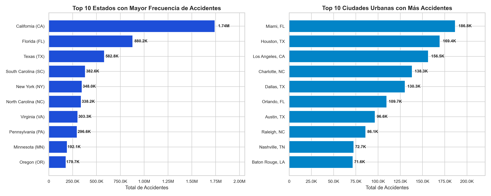
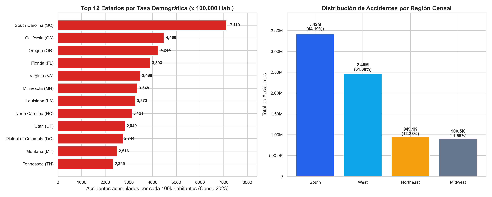

### 2. Hora del Día y Días de la Semana Críticos (Req. 2 y 6)
- **Hora pico:** Las **07:00h** (`587,472` eventos, `7.6%`), con patrón **bimodal laboral** (07–09h y 15–18h).
- **Día crítico:** El **Viernes** concentra el máximo (`1,366,499`, `17.68%`), mientras el fin de semana (Sáb+Dom = `1,231,427`, `15.93%`) reduce frecuencia pero registra **mayor severidad media** (`2.259` domingo).

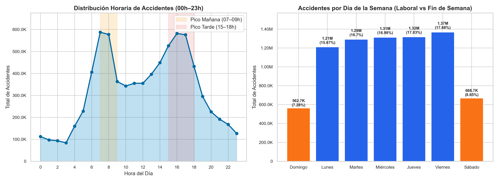
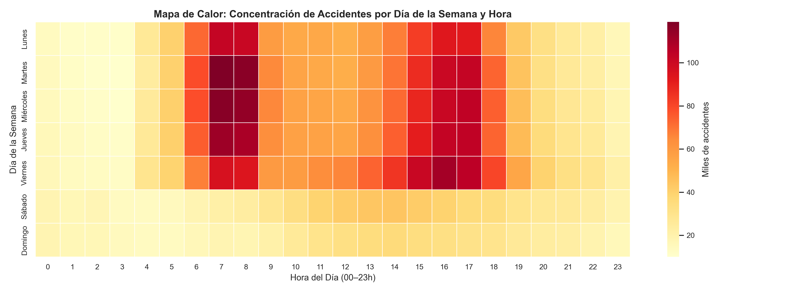

### 3. Severidad y Duración del Incidente (Req. 3 y 7)
- **Severidad:** Nivel 2 (`79.67%`), Nivel 3 (`16.81%`), Nivel 4 (`2.65%`) y Nivel 1 (`0.87%`).
- **Duración:** La brecha entre **media bruta (`444.4 min`)** y **mediana (`74.8 min`)** responde a `34,981` *outliers* `>24h`. Depurando `≤24h`, la media desciende a **`108.0 min`** (`185.9 min` en Sev. 4 vs `45.7 min` en Sev. 1).

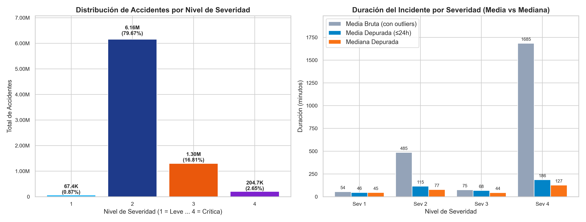

### 4. Relación con Condiciones Climáticas (Req. 4)
- Por volumen predominan **Despejado (`44.06%`)** y **Nublado (`40.94%`)**, pero la proporción de accidentes graves (`Sev 3–4`) sube en **Lluvia (`22.76%`)** y **Nieve/Hielo (`19.95%`)** (vs `16.91%` en Despejado) conforme cae la visibilidad (`< 3.1 mi` en Niebla/Nieve).

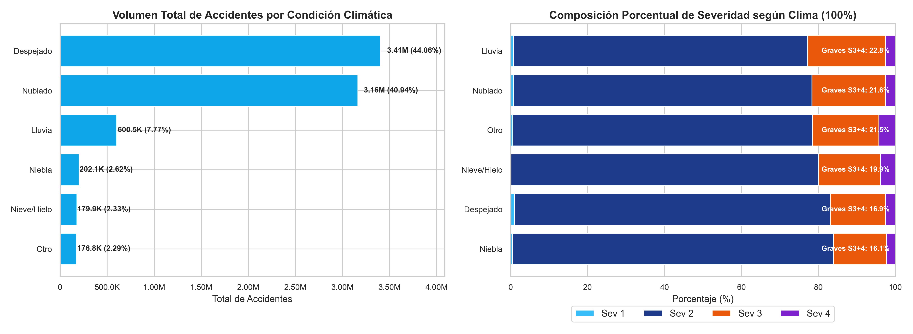

### 5. Tipos de Vía Más Peligrosos y Top 10 Calles Reales (Req. 5)
- **Autopistas / Interstates** agrupan el **`32.44%` de incidentes graves** (vs `10.17%` en calles urbanas).
- **Top 3 vías reales por volumen:** `I-95 N` (`78,430`), `I-95 S` (`74,528`) e `I-5 N` (`71,968`), corrigiendo el ordenamiento alfabético descendente (`Zuni Rd SE`) observado en Power BI.

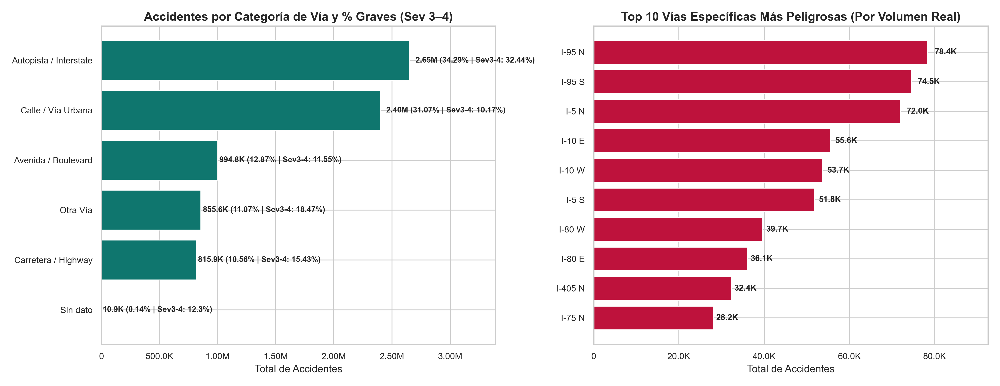

### 6. Tendencias Anuales y Estacionalidad Mensual (Req. 8)
- Crecimiento sostenido desde **2016 (`410,821`)** hasta el máximo histórico de **2022 (`1,762,452`)**, cerrando 2023 con Q1 parcial (`246,633`). Estacionalmente lidera **Diciembre (`847,343`, `10.96%`)**.

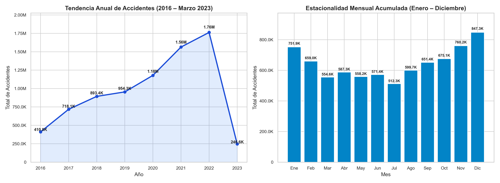

### 7. Accidentes por Tipo de Vehículo Involucrado — NLP sobre Description (Req. 9)
- Tras filtrar toponimias viales falsas (`"I-80 Bus"`, `"Van Ness Ave"`), se identificaron `68,252` menciones válidas: **Automóvil / Multivehículo (`45,195`; `43.02%` graves)** y **Camión / Tráiler (`16,389`; mayor severidad promedio `2.521` y `124.95 min`)** encabezan tanto volumen como impacto vial.

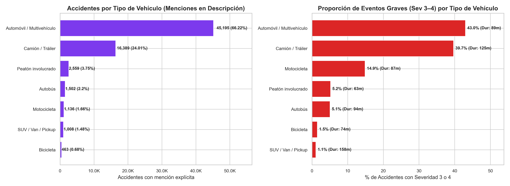

### 8. Distribución Geoespacial de Puntos Críticos y Correlaciones (Req. 10 y EDA)
- Los clústeres de cuadrícula `0.1° × 0.1°` confirman alta densidad en **Sur de California, Miami–Orlando, Houston–Dallas y el corredor Noreste**, con fuerte concentración en semáforos (`1.14M`) y cruces peatonales (`874K`).

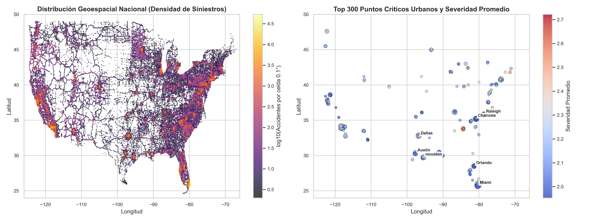
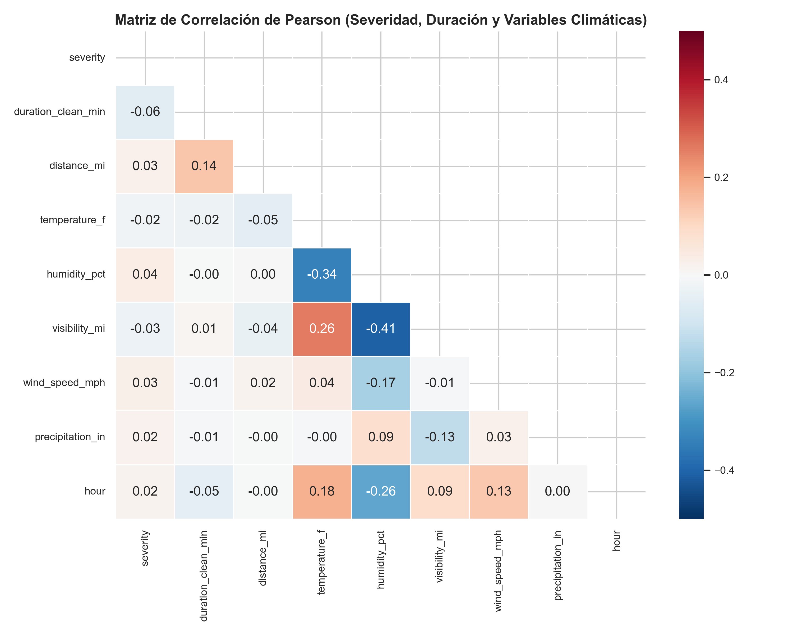

### 9. Resultados y Visualizaciones del Análisis ANOVA
- **Duración ~ Severidad:** `F = 86,966.69`, `p < 1e-300`, `η² = 0.0328` (todos los pares significativos en Tukey HSD).
- **Severidad ~ Clima × Franja Horaria (Factorial 2 Vías):** Efectos principales e interacción altamente significativos (`F = 87.58`, `p < 1e-300`), destacando mayor severidad nocturna bajo lluvia (`2.279`) y diurna bajo nieve/hielo (`2.259`).

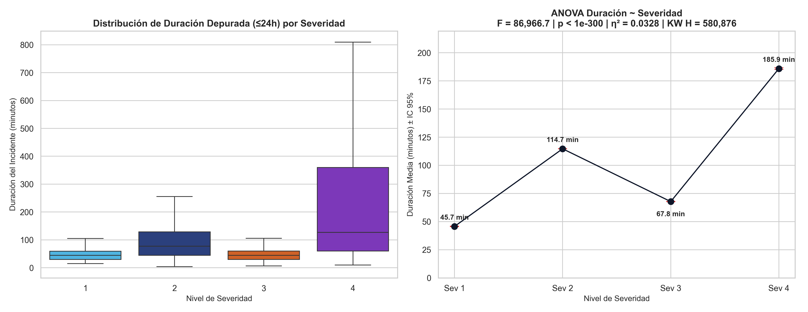
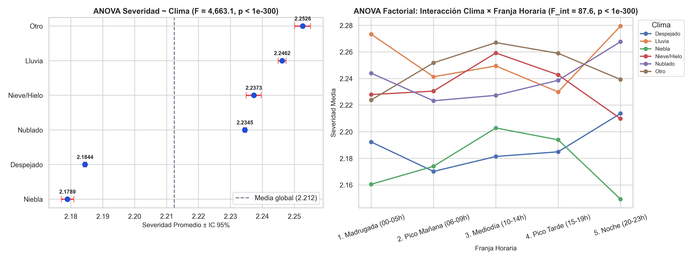
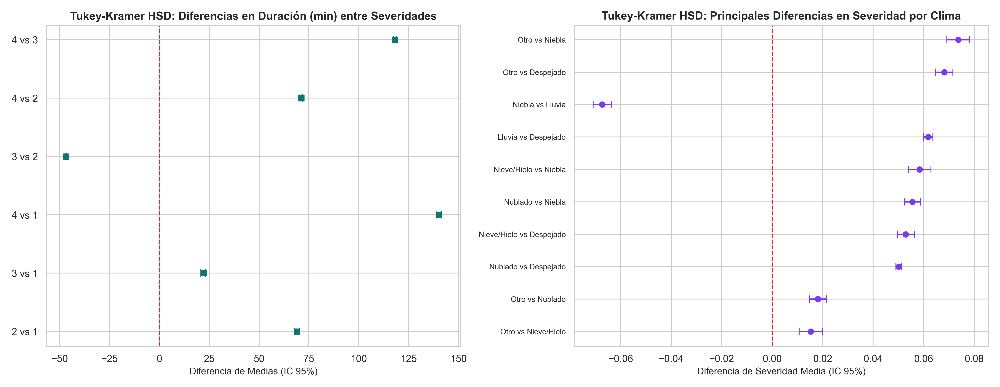

---

## 📊 Tablero Power BI, DAX y Código ETL (Entregables 2 y 3)

- 🌐 **Despliegue Web HTML:** [`powerbi/dashboard_powerbi.html`](powerbi/dashboard_powerbi.html) (portal interactivo con las 8 vistas del tablero, medidas DAX, código M y visor Publish-to-Web).
- 📐 **Medidas DAX explicadas:** [`powerbi/dax_measures.md`](powerbi/dax_measures.md)
- ⚙️ **Script Power Query (M):** [`powerbi/power_query_etl.pq`](powerbi/power_query_etl.pq)
- 🗄️ **Consultas SQL analíticas:** [`sql/queries_analisis.sql`](sql/queries_analisis.sql)
- ⚡ **Pipeline ETL Python y PySpark:** [`src/etl_us_accidents.py`](src/etl_us_accidents.py) · [`src/etl_pyspark.py`](src/etl_pyspark.py)

<details>
<summary>🖼️ Ver las 8 capturas documentadas del Tablero Power BI Desktop</summary>

1. **Estado y Top 10 Ciudades:** 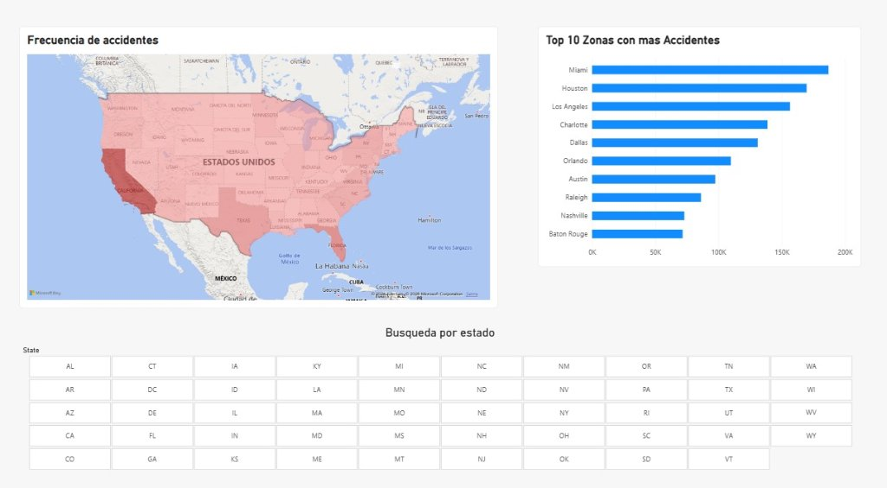
2. **KPIs, Hora y Día de la Semana:** 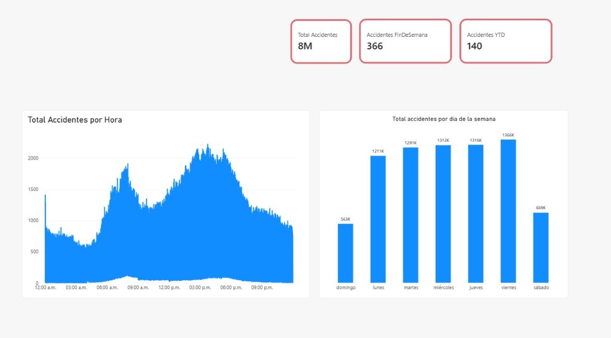
3. **Severidad y Clima al 100%:** 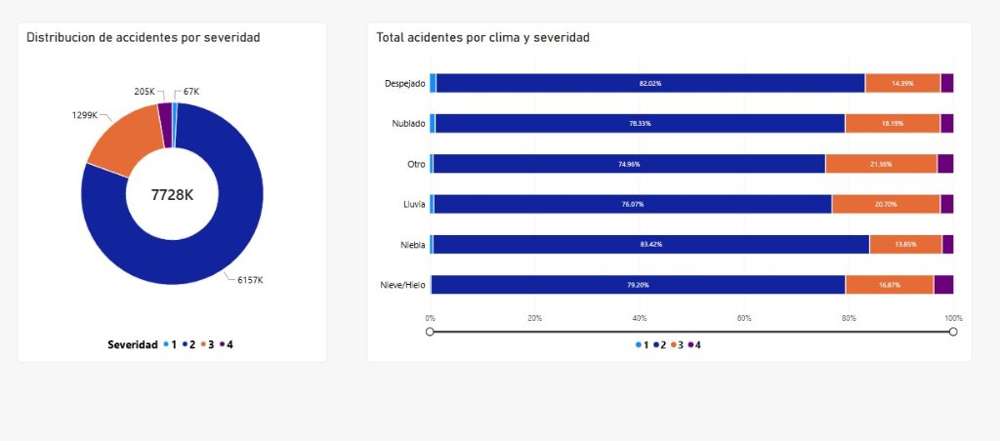
4. **Accidentes por Clima y Estado:** 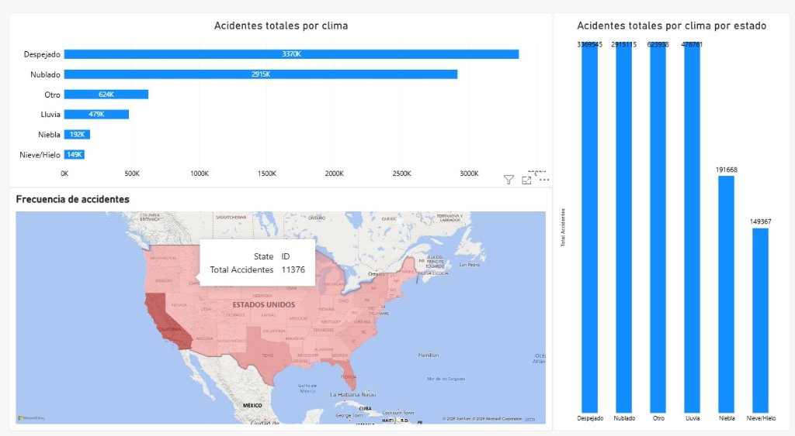
5. **Top 10 Vías (Auditoría de ordenamiento):** 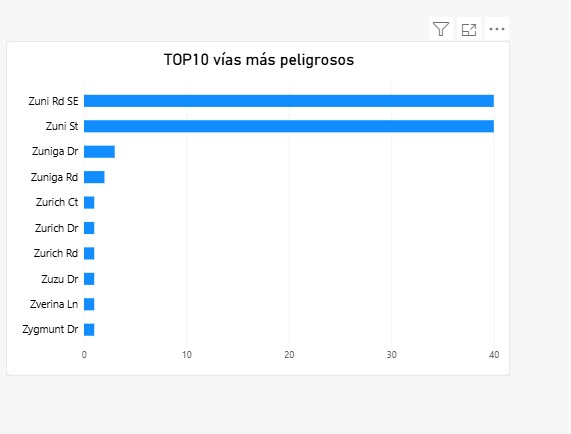
6. **Duración Promedio vs Mediana:** 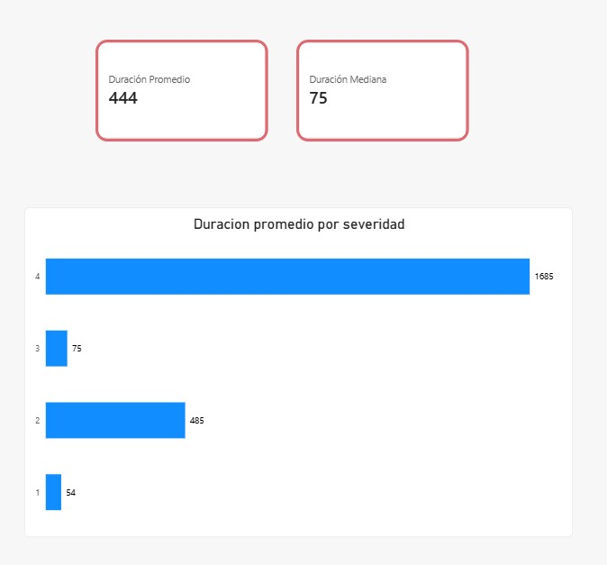
7. **Tendencias Anuales/Mensuales y Var MoM %:** 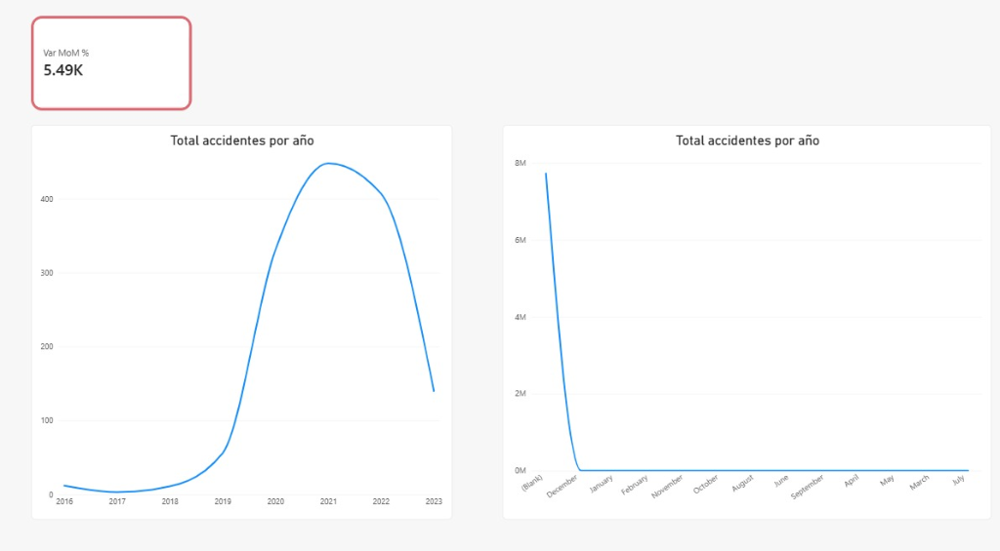
8. **Mapa Geoespacial de Severidad:** 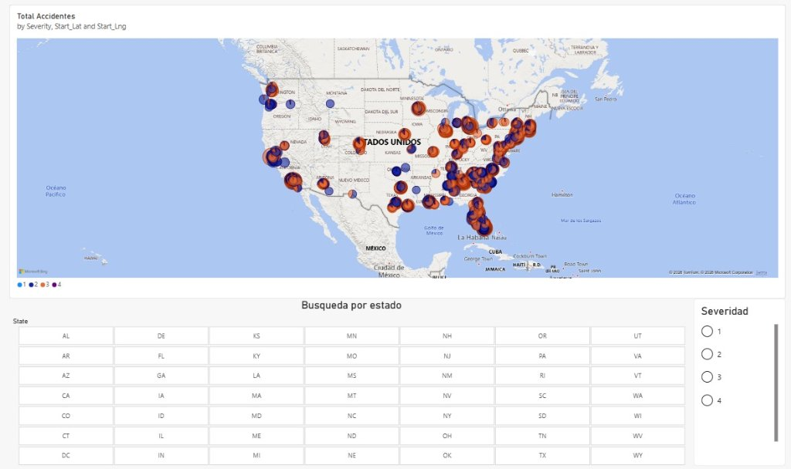

</details>

---

## 📄 Entregables Documentales y Presentación Oral (Entregables 1 y 4)

- 📘 **Informe Técnico (PDF):** [`docs/informe_tecnico.pdf`](docs/informe_tecnico.pdf)
- 📝 **Informe Técnico (Word):** [`docs/informe_tecnico.docx`](docs/informe_tecnico.docx)
- 🌐 **Informe Técnico (HTML & Markdown):** [`docs/informe_tecnico.html`](docs/informe_tecnico.html) · [`docs/informe_tecnico.md`](docs/informe_tecnico.md)
- 🎤 **Presentación Oral (15 Slides PPTX & Guion):** [`docs/presentacion_oral.pptx`](docs/presentacion_oral.pptx) · [`docs/guion_presentacion_oral.md`](docs/guion_presentacion_oral.md)
- 🖥️ **Portal HTML Raíz:** [`index.html`](index.html)

---

## 🚀 Cómo Reproducir el Pipeline Completo

> **Nota sobre el CSV original:** Por superar el límite de 100 MB de GitHub (~3.06 GB), `US_Accidents_March23.csv` y los binarios generados están excluidos en `.gitignore`. Descarga el CSV desde [Kaggle US Accidents](https://www.kaggle.com/datasets/sobhanmoosavi/us-accidents) y ubícalo en `data/US_Accidents_March23.csv`.

```bash
# 1. Instalar dependencias
pip install -r requirements.txt

# 2. Ejecutar pipeline ETL (genera Parquet + base SQLite indexada)
python src/etl_us_accidents.py

# 3. Ejecutar consultas SQL y generar las gráficas en Python
python src/analysis_sql_and_charts.py

# 4. Ejecutar pruebas ANOVA y generar las gráficas estadísticas
python src/anova_analysis.py

# 5. (Opcional) Ejecutar versión distribuida en PySpark
python src/etl_pyspark.py

# 6. Regenerar todos los entregables (PDF, Word, PPTX, HTML, MD y README)
python src/generate_deliverables.py
```
