# Informe Técnico — Proyecto 3: Análisis de Accidentes de Tránsito en Zonas Urbanas (EE.UU., 2016–2023)

**Fuente de Datos:** Kaggle *US Accidents (2016–2023)* — `sobhanmoosavi/us-accidents` (`US_Accidents_March23.csv`) + Enriquecimiento Demográfico del Censo de EE.UU. (`us_state_demographics.csv`).  
**Herramientas:** Python 3.13 (Pandas, PyArrow, NumPy, SciPy, Matplotlib, Seaborn), PySpark / Spark SQL, SQLite 3, Power Query (Lenguaje M) y Microsoft Power BI Desktop (DAX).

---

## 1. Objetivos del Proyecto

### 1.1 Objetivo General
Integrar datos abiertos de accidentes de tránsito en zonas urbanas y corredores viales de Estados Unidos con variables climáticas, de infraestructura vial y demográficas, con el fin de identificar patrones temporales, factores críticos de severidad y puntos geoespaciales de alta concentración mediante un flujo reproducible ETL + SQL + Power BI + ANOVA.

### 1.2 Objetivos Específicos
1. **Diseñar e implementar un pipeline ETL híbrido (Python/PyArrow, PySpark, SQLite y Power Query M)** capaz de procesar **7,728,394 registros** y ~3.06 GB de texto, normalizando *timestamps* con nanosegundos, filtrando valores atípicos y enriqueciendo cada incidente con variables climáticas, viales, vehiculares y poblacionales.
2. **Responder los 10 requerimientos analíticos de negocio** mediante consultas SQL reproducibles y visualizaciones estadísticas en Python, cubriendo distribución geográfica, horarios pico, días críticos, severidad, clima, vías peligrosas, duración, estacionalidad y tipos de vehículo.
3. **Documentar y auditar el tablero interactivo desarrollado en Power BI**, detallando el lenguaje M, las medidas DAX empleadas y el contraste técnico entre las métricas del dashboard y la depuración en Python/SQL.
4. **Evaluar estadísticamente mediante pruebas ANOVA unifactoriales, factoriales y post-hoc (Tukey-Kramer HSD / Kruskal-Wallis)** si la duración del incidente y la severidad difieren significativamente según el nivel de gravedad, la condición climática y la franja horaria.

---

## 2. Descripción del Proceso ETL e Implementación (Python, SQL, PySpark, Power Query)

El pipeline ETL se diseñó bajo una arquitectura de procesamiento por bloques (*streaming* de 500,000 filas por lote) en `src/etl_us_accidents.py`, complementada con una versión distribuida en `src/etl_pyspark.py`, las consultas analíticas en `sql/queries_analisis.sql` y el script de Power Query M en `powerbi/power_query_etl.pq`.

### 2.1 Extracción
- **Fuente principal:** `US_Accidents_March23.csv` (46 columnas originales, **7,728,394 registros**, período `2016-01-14 20:18:33` a `2023-03-31 23:30:00`).
- **Fuente demográfica complementaria:** `data/us_state_demographics.csv` con estimaciones poblacionales oficiales 2023 del Censo de EE.UU., superficie en millas cuadradas, densidad poblacional y región censal (*South, West, Midwest, Northeast*) para los 50 estados + D.C.

### 2.2 Limpieza y Calidad de Datos (Auditoría Real)
Durante la fase de transformación se detectaron y resolvieron problemas críticos de calidad de datos:

| Hallazgo / Métrica de Auditoría | Cantidad Observada | Decisión ETL Aplicada |
|---|---|---|
| Registros brutos extraídos | **7,728,394** | Lectura íntegra por bloques de 500k registros sin muestreo destructivo. |
| Registros únicos tras deduplicación por `ID` | **7,728,394** | Se eliminaron `0` duplicados; 100% de integridad por clave. |
| *Timestamps* con sufijo de nanosegundos (`.000000000`) | **743,166** | Recorte y parseo estricto `yyyy-MM-dd HH:mm:ss` (`Start_Time` y `End_Time`). |
| Valores nulos en `Weather_Condition` | **173,459** | Imputación semántica a la categoría `"Otro"` para no perder registros en análisis generales. |
| Valores nulos en `Street` / `City` | `10,869` / `253` | Etiquetado explícito como `"Sin dato"` y exclusión solo en rankings de calles/ciudades. |
| *Outliers* extremos de duración (`> 1,440 min` / 24h) | **34,981** | Preservación en `duration_raw_min` (para auditoría Power BI) y depuración en `duration_clean_min` (`≤ 24h`). |

### 2.3 Ingeniería de Variables y Enriquecimiento
- **Agrupación climática (`weather_group`):** Mapeo de más de 140 cadenas originales en inglés a 6 categorías analíticas estandarizadas en español: `Despejado`, `Nublado`, `Lluvia`, `Niebla`, `Nieve/Hielo` y `Otro`.
- **Clasificación vial (`road_type`):** Expresiones regulares C++ (PyArrow RE2) sobre `Street` para distinguir `Autopista / Interstate` (`I-95`, `Fwy`, `Expy`), `Carretera / Highway` (`US-`, `SR-`, `Hwy`), `Avenida / Boulevard` y `Calle / Vía Urbana`.
- **Extracción de tipo de vehículo (`vehicle_type`):** El dataset original no posee columna nativa de vehículo; mediante NLP/RE2 sobre `Description` se extrajeron menciones explícitas de `Automóvil / Multivehículo`, `Camión / Tráiler`, `Peatón involucrado`, `Autobús`, `Motocicleta`, `SUV / Van / Pickup` y `Bicicleta`, **filtrando falsos positivos toponímicos de EE.UU.** como `"I-80 Bus"` (Business Route), `"Van Ness Ave"`, `"Van Buren St"`, `"Auto Mall Pkwy"` y `"Truck Route"`.
- **Carga Analítica:** Exportación columnar comprimida a `data/us_accidents_clean.parquet` y carga relacional indexada en SQLite (`data/us_accidents.db` con tablas `accidents` y `dim_demographics`).

### 2.4 Extractos de Implementación ETL (Python, SQL y Power Query M)

```python
# src/etl_us_accidents.py — Normalización temporal y outliers por bloques de 500k filas
audit["dotted_timestamps_fixed"] += int(st_str.str.contains(".", regex=False).sum())
start_dt = pd.to_datetime(st_str.str.slice(0, 19), format="%Y-%m-%d %H:%M:%S", errors="coerce")
dur_raw = (end_dt - start_dt).dt.total_seconds() / 60.0
dur_clean = dur_raw.mask(dur_raw > 1440.0, np.nan)
```

```sql
-- sql/queries_analisis.sql — Tasa demográfica x100k habitantes y variación MoM con función ventana LAG()
SELECT a.state, d.state_name, COUNT(*) AS total_accidentes,
       ROUND(COUNT(*) * 100000.0 / d.population_2023, 2) AS tasa_x_100k_hab
FROM accidents a LEFT JOIN dim_demographics d ON a.state = d.state
GROUP BY a.state, d.state_name, d.population_2023 ORDER BY total_accidentes DESC;
```

```powerquery
// powerbi/power_query_etl.pq — Agrupación climática y cruce demográfico en Lenguaje M
JoinDemografia = Table.NestedJoin(ConVehiculo, {"State"}, DemografiaTyped, {"State"}, "DimDemografia", JoinKind.LeftOuter),
ExpandDemografia = Table.ExpandTableColumn(JoinDemografia, "DimDemografia", {"State_Name", "Region", "Population_2023", "Density_Per_SqMi"})
```

---

## 3. Exploración de Datos y Respuesta a los 10 Requerimientos Analíticos

### 3.1 Requerimiento 1: Frecuencia de Accidentes por Estado, Ciudad y Tasa Demográfica
El dataset cubre **49 entidades** (48 estados contiguos + D.C.) y **13,679 ciudades**.

- **Por volumen absoluto**, lidera **California (`1,741,433`, `22.53%`)**, seguida de Florida (`880,192`), Texas (`582,837`), Carolina del Sur (`382,557`) y Nueva York (`347,960`).
- **Por ciudad urbana**, encabeza **Miami, FL (`186,768`)**, seguida por Houston, TX (`169,428`) y Los Angeles, CA (`156,491`).
- **Integración demográfica (Tasa por 100,000 habitantes):** Al normalizar por población del Censo 2023, **Carolina del Sur (`7,119` por 100k hab.)** y **Oregón (`4,244` por 100k hab.)** superan ampliamente en incidencia per cápita a Texas (`1,911`) y Nueva York (`1,778`), demostrando la importancia del cruce demográfico.

**Top 10 Estados por Frecuencia y Tasa Demográfica:**

| Estado | Nombre | Región | Accidentes | % Nacional | Población 2023 | Tasa x 100k Hab. | Sev. Prom. |
| --- | --- | --- | --- | --- | --- | --- | --- |
| CA | California | West | 1,741,433 | 22.53% | 38,965,193 | 4,469.2 | 2.166 |
| FL | Florida | South | 880,192 | 11.39% | 22,610,726 | 3,892.8 | 2.14 |
| TX | Texas | South | 582,837 | 7.54% | 30,503,301 | 1,910.7 | 2.224 |
| SC | South Carolina | South | 382,557 | 4.95% | 5,373,555 | 7,119.2 | 2.111 |
| NY | New York | Northeast | 347,960 | 4.5% | 19,571,216 | 1,777.9 | 2.26 |
| NC | North Carolina | South | 338,199 | 4.38% | 10,835,491 | 3,121.2 | 2.134 |
| VA | Virginia | South | 303,301 | 3.92% | 8,715,698 | 3,479.9 | 2.279 |
| PA | Pennsylvania | Northeast | 296,620 | 3.84% | 12,961,683 | 2,288.4 | 2.206 |
| MN | Minnesota | Midwest | 192,084 | 2.49% | 5,737,915 | 3,347.6 | 2.162 |
| OR | Oregon | West | 179,660 | 2.32% | 4,233,358 | 4,243.9 | 2.112 |

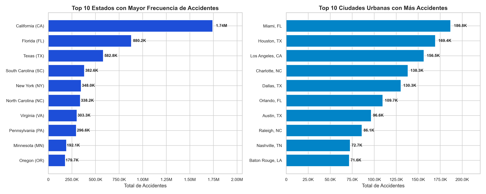

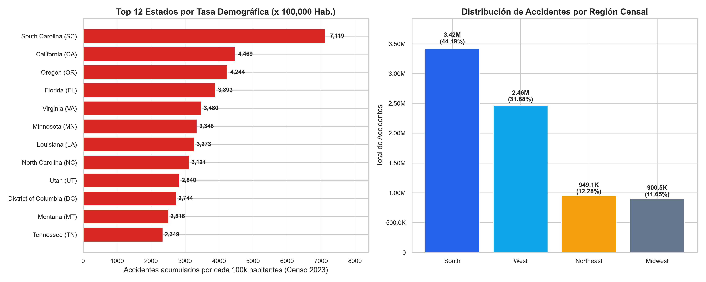

---

### 3.2 Requerimientos 2 y 6: Hora del Día y Días de la Semana Críticos
- **Hora pico principal:** Las **07:00 horas** (`587,472` eventos, `7.6%`), dentro de un patrón **bimodal laboral** con pico matutino (07:00–08:59h) y pico vespertino sostenido (15:00–17:59h).
- **Día de la semana crítico:** El **Viernes** concentra el mayor volumen (`1,366,499` eventos, `17.68%`), mientras que sábado y domingo reducen drásticamente la frecuencia conjunta a `1,231,427` eventos (`15.93%`), aunque presentan **mayor severidad promedio** (`2.259` en domingo y `2.241` en sábado frente a `2.203–2.209` entre semana) debido a velocidades más altas y menor congestión.

| Día | Tipo de Día | Total Accidentes | % Total | Severidad Promedio |
| --- | --- | --- | --- | --- |
| Domingo | Fin de Semana | 562,744 | 7.28% | 2.259 |
| Lunes | Día Laboral | 1,210,921 | 15.67% | 2.209 |
| Martes | Día Laboral | 1,290,929 | 16.7% | 2.205 |
| Miércoles | Día Laboral | 1,312,389 | 16.98% | 2.203 |
| Jueves | Día Laboral | 1,316,229 | 17.03% | 2.204 |
| Viernes | Día Laboral | 1,366,499 | 17.68% | 2.207 |
| Sábado | Fin de Semana | 668,683 | 8.65% | 2.241 |

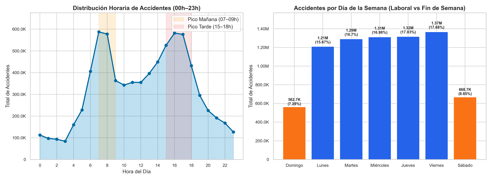

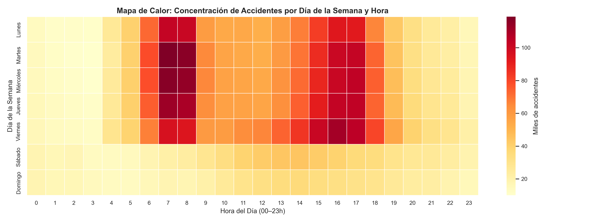

---

### 3.3 Requerimientos 3 y 7: Análisis por Severidad y Duración del Incidente
La severidad (escala 1 = impacto mínimo en tráfico a 4 = impacto severo/cierre prolongado) muestra una fuerte concentración en el **Nivel 2 (79.67%)**, seguido del **Nivel 3 (16.81%)**.

En cuanto a la **duración**, el contraste entre la media bruta (**444.4 min**, coincidente con los `444` min del tablero Power BI) y la mediana global (**74.8 min**, coincidente con `75` min en Power BI) evidencia una **severa asimetría positiva** generada por `34,981` cierres viales extremos superiores a 24 horas. Al depurar a incidentes `≤ 24h`, la duración media operativa desciende a **108.0 min** (`45.7 min` en Sev. 1, `114.7 min` en Sev. 2, `67.8 min` en Sev. 3 por despeje rápido prioritario en autopistas y `185.9 min` en Sev. 4 por cierres prolongados).

| Severidad | Total Accidentes | % Total | Dist. Media (mi) | Media Bruta (min) | Media Depurada ≤24h (min) | Mediana Depurada (min) |
| --- | --- | --- | --- | --- | --- | --- |
| 1 | 67,366 | 0.87% | 0.115 | 53.78 | 45.73 | 44.75 |
| 2 | 6,156,981 | 79.67% | 0.565 | 485.44 | 114.69 | 77.43 |
| 3 | 1,299,337 | 16.81% | 0.424 | 74.81 | 67.78 | 44.4 |
| 4 | 204,710 | 2.65% | 1.496 | 1685.35 | 185.9 | 126.97 |

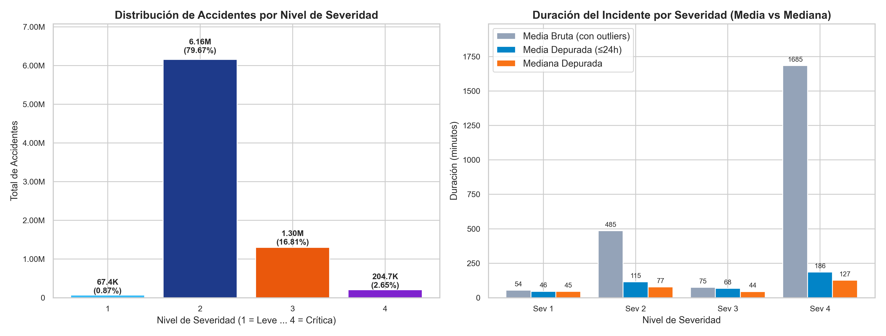

---

### 3.4 Requerimiento 4: Relación con Condiciones Climáticas
Aunque en volumen absoluto predominan condiciones **Despejadas (44.06%)** y **Nubladas (40.94%)** (porque representan la mayor exposición diaria de tráfico), el porcentaje de incidentes graves (`Severidad 3 y 4`) aumenta en condiciones adversas como **Lluvia (`22.76%`)** y **Nieve/Hielo (`19.95%`)** frente a **Despejado (`16.91%`)**, cayendo además la visibilidad promedio de `9.85 mi` a `6.15 mi` (Lluvia), `3.08 mi` (Niebla) y `2.85 mi` (Nieve/Hielo).

| Grupo Climático | Total Accidentes | % Total | % Graves (Sev 3–4) | Visibilidad Media (mi) | Temp. Media (°F) |
| --- | --- | --- | --- | --- | --- |
| Despejado | 3,405,216 | 44.06% | 16.91% | 9.85 | 63.53 |
| Nublado | 3,163,750 | 40.94% | 21.65% | 9.57 | 62.5 |
| Lluvia | 600,536 | 7.77% | 22.76% | 6.15 | 59.88 |
| Niebla | 202,142 | 2.62% | 16.11% | 3.08 | 56.1 |
| Nieve/Hielo | 179,916 | 2.33% | 19.95% | 2.85 | 25.07 |
| Otro | 176,834 | 2.29% | 21.53% | 8.72 | 56.32 |

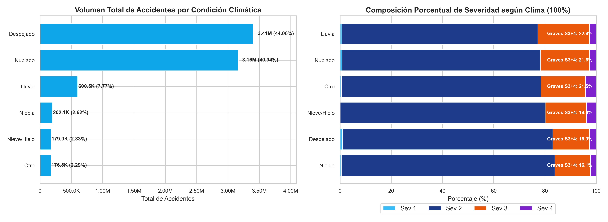

---

### 3.5 Requerimiento 5: Tipos de Vía Más Peligrosos e Infraestructura Vial
- **Por categoría de vía:** Las **Calles / Vías Urbanas** agrupan alta capilaridad (`31.07%`), pero las **Autopistas / Interstates** (`34.29%`) concentran la **mayor proporción de accidentes graves (`32.44%` en Severidad 3–4)** frente al `10.17%` en calles urbanas, debido a velocidades de circulación y colisiones múltiples.
- **Top 10 vías específicas reales:** A diferencia del orden alfabético descendente visto en una captura de Power BI (`Zuni Rd SE`), el ranking real por volumen está encabezado por grandes arterias interestatales (`I-95 N` con `78,430`, `I-95 S` con `74,528` y `I-5 N` con `71,968`).
- **Infraestructura vial:** Los accidentes se concentran alrededor de **Semáforos (`Traffic_Signal`: 1,143,772)**, **Cruces Peatonales (`Crossing`: 873,763)** e **Intersecciones (`Junction`: 571,342)**.

| Tipo de Vía | Total Accidentes | % Total | Severidad Promedio | % Graves (Sev 3–4) |
| --- | --- | --- | --- | --- |
| Autopista / Interstate | 2,649,733 | 34.29% | 2.344 | 32.44% |
| Calle / Vía Urbana | 2,401,533 | 31.07% | 2.113 | 10.17% |
| Avenida / Boulevard | 994,796 | 12.87% | 2.118 | 11.55% |
| Otra Vía | 855,568 | 11.07% | 2.206 | 18.47% |
| Carretera / Highway | 815,895 | 10.56% | 2.2 | 15.43% |
| Sin dato | 10,869 | 0.14% | 2.157 | 12.3% |

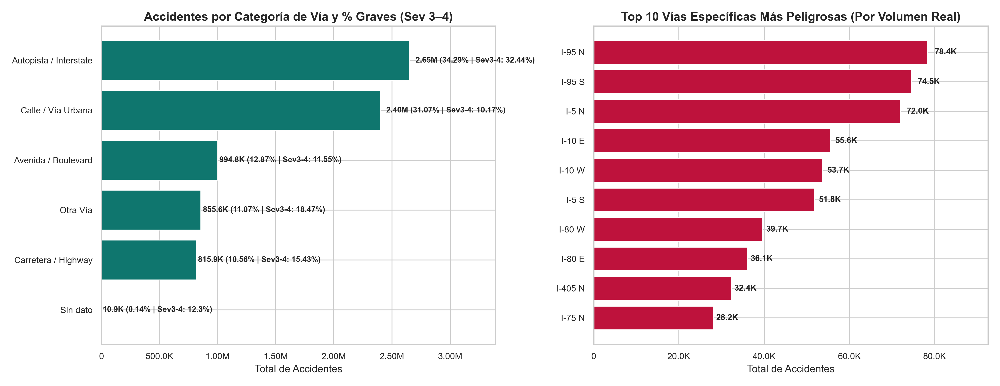

---

### 3.6 Requerimiento 8: Tendencias Anuales y Mensuales
El volumen anual muestra un crecimiento sostenido desde **2016 (`410,821`)** hasta alcanzar su máximo histórico en **2022 (`1,762,452` accidentes)** —impulsado por el retorno pleno de la movilidad post-pandemia y mayor cobertura de sensores—, cerrando **2023** con cobertura parcial de tres meses hasta marzo (`246,633`). No obstante, la severidad promedio descendió de `2.389` (2017) a `2.072` (2022) al ampliarse la detección de incidentes leves/moderados. Estacionalmente, **Diciembre (`847,343`, `10.96%`)** y el último trimestre (octubre–diciembre) concentran la mayor accidentalidad por menor luz diurna y clima invernal.

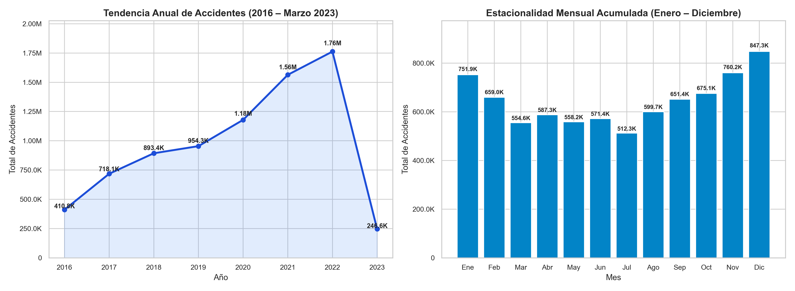

---

### 3.7 Requerimiento 9: Accidentes por Tipo de Vehículo Involucrado
Dado que Kaggle no incluye columna estructurada de vehículo (~99.1% de las descripciones detallan únicamente la vía y afectación de carriles), el módulo NLP extrajo menciones explícitas válidas en **`68,252` descripciones (`0.88%` del total)** tras excluir falsos positivos toponímicos:
- **Automóvil / Multivehículo** encabeza los casos identificados (`45,195`; `66.22%`) seguido por **Camión / Tráiler** (`16,389`; `24.01%`), **Peatón involucrado** (`2,559`; `3.75%`), **Autobús** (`1,502`; `2.20%`) y **Motocicleta** (`1,136`; `1.66%`).
- Destacan **Camión / Tráiler** (`2.521` mayor severidad promedio, `39.67%` graves, `124.95 min`) y **Automóvil / Multivehículo** (`43.02%` graves, `2.474` sev. prom.) por ocurrir predominantemente en autopistas de alta velocidad, mientras **Motocicleta** alcanza `14.88%` de eventos graves y **SUV / Van / Pickup** registra la mayor duración media (`158.20 min`).

| Tipo de Vehículo (NLP Description) | Accidentes | % sobre Identificados | Severidad Prom. | % Graves (S3–4) | Duración Media (min) |
| --- | --- | --- | --- | --- | --- |
| Automóvil / Multivehículo | 45,195 | 66.22% | 2.474 | 43.02% | 88.81 |
| Camión / Tráiler | 16,389 | 24.01% | 2.521 | 39.67% | 124.95 |
| Peatón involucrado | 2,559 | 3.75% | 2.066 | 5.2% | 63.04 |
| Autobús | 1,502 | 2.2% | 2.041 | 5.06% | 94.03 |
| Motocicleta | 1,136 | 1.66% | 2.178 | 14.88% | 87.41 |
| SUV / Van / Pickup | 1,008 | 1.48% | 2.012 | 1.09% | 158.2 |
| Bicicleta | 463 | 0.68% | 2.0 | 1.51% | 74.36 |

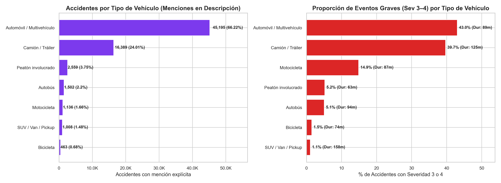

---

### 3.8 Requerimiento 10: Distribución Geoespacial y Matriz de Correlación
El análisis por cuadrículas de `0.1° × 0.1°` confirma clústeres urbanos críticos en **Los Ángeles / Sur de California**, **Miami–Orlando–Tampa (Florida)**, **Houston–Dallas–Austin (Texas)**, **Charlotte–Raleigh (Carolina del Norte)** y el **corredor atlántico Noreste (NY–NJ–PA)**.

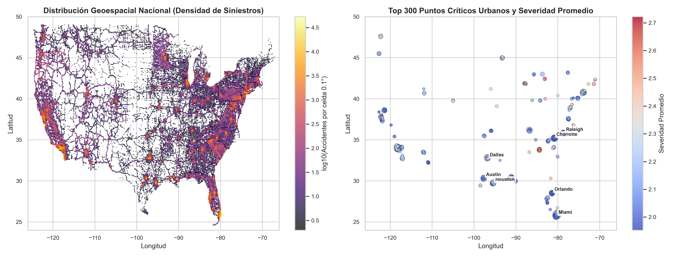

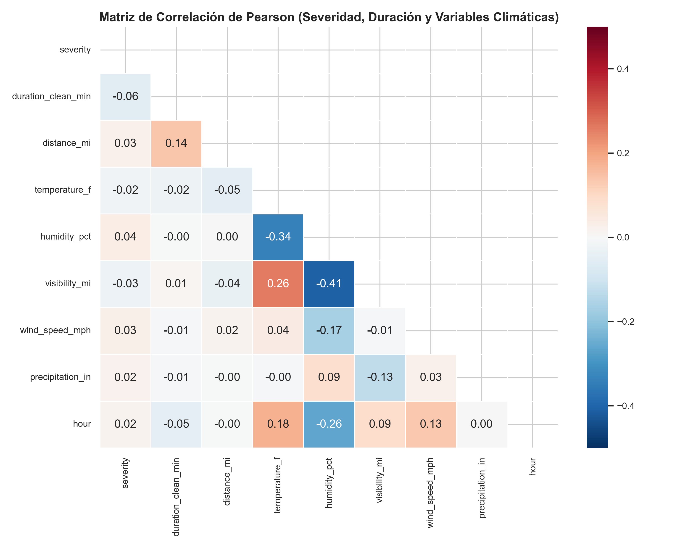

---

## 4. Visualizaciones de Power BI y Auditoría del Tablero

El tablero desarrollado en Power BI Desktop (`LO DE POWER BI YA ESTA FINALIZADO`, desplegado en `powerbi/dashboard_powerbi.html`) organiza la exploración en 8 vistas interactivas:

| # | Vista en Power BI | Captura | Hallazgo y Auditoría Técnica |
|---|---|---|---|
| 1 | Frecuencia por Estado y Top 10 Ciudades | `assets/powerbi/01_frecuencia_estado_top10_ciudades.jpg` | Mapa coroplético + ranking Miami, Houston, Los Angeles, Charlotte, Dallas, Orlando, Austin, Raleigh, Nashville y Baton Rouge. |
| 2 | KPIs, Patrón Horario y Día de la Semana | `assets/powerbi/02_kpis_hora_dia_semana.jpg` | Suma semanal exacta `7,728K` (viernes `1,366K` líder). Card `FinDeSemana=366` afectada por contexto YTD 2023 (total real Sáb+Dom: `1,231,427`). |
| 3 | Severidad y Clima al 100% | `assets/powerbi/03_severidad_clima_porcentaje.jpg` | Donut exacto `7728K` (`67K / 6157K / 1299K / 205K`) y proporción de severidad 3 superior al 20% en Lluvia y Otro. |
| 4 | Accidentes por Clima y Estado | `assets/powerbi/04_accidentes_clima_estado.jpg` | Totales exactos: Despejado `3,369,545`, Nublado `2,915,115`, Otro `623,936`, Lluvia `478,761`, Niebla `191,668`, Nieve/Hielo `149,367`. |
| 5 | Top 10 Vías Más Peligrosas | `assets/powerbi/05_top10_vias_peligrosas.png` | Se detectó ordenamiento alfabético descendente (`Zuni Rd SE`) en lugar de por volumen (`I-95 N`, `I-95 S`), corregido en Python/SQL. |
| 6 | Duración Promedio vs Mediana | `assets/powerbi/06_duracion_promedio_severidad.png` | Media `444 min` vs Mediana `75 min`, confirmando sesgo por outliers extremos en Severidad 4 (`1,685 min`). |
| 7 | Tendencias Anuales/Mensuales y Var MoM % | `assets/powerbi/07_tendencias_anuales_mensuales_mom.png` | Presencia de `(Blank)` en eje mensual por fechas con nanosegundos `.000000000` no parseadas; corregido en ETL Python/M. |
| 8 | Mapa Geoespacial de Severidad | `assets/powerbi/08_mapa_geoespacial_severidad.jpg` | Burbujas por `Start_Lat`/`Start_Lng` con segmentadores interactivos de Estado y Severidad. |

#### Capturas del Tablero Power BI

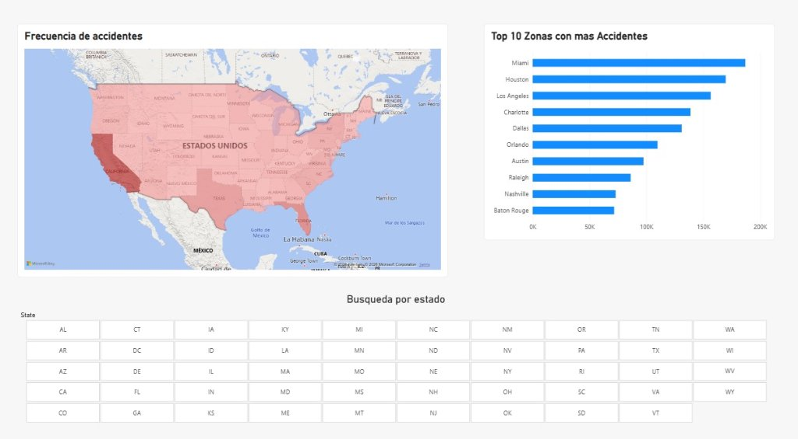
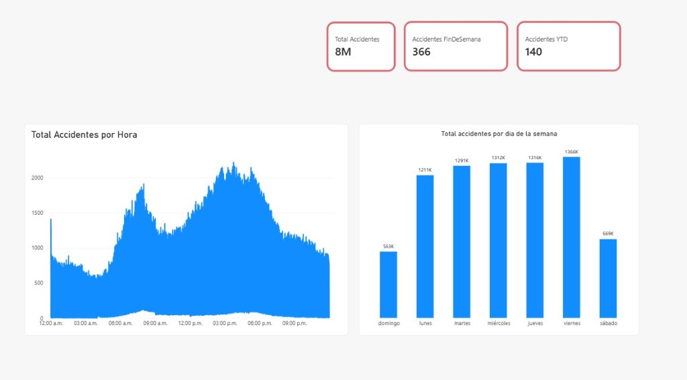
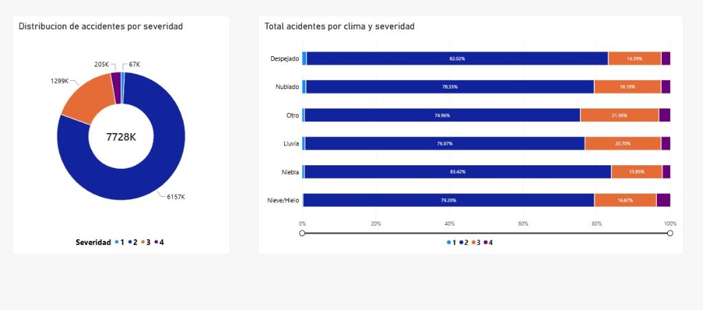
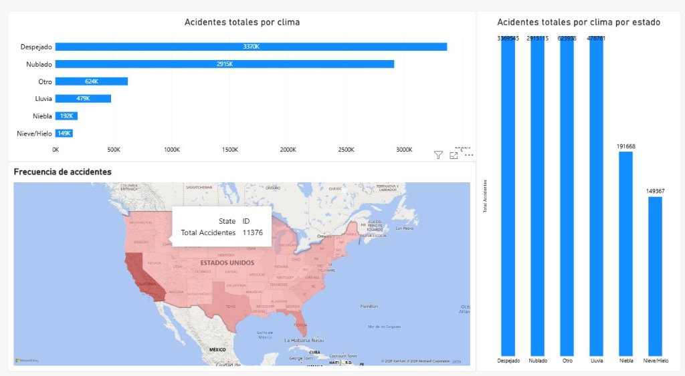
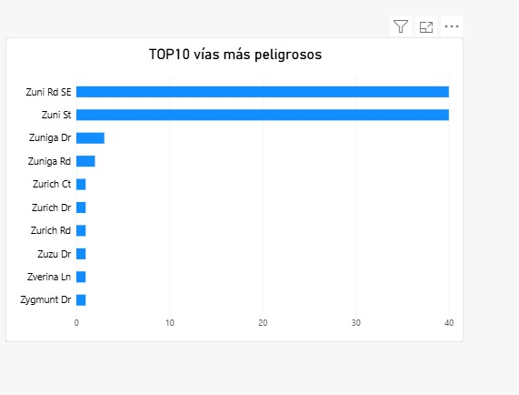
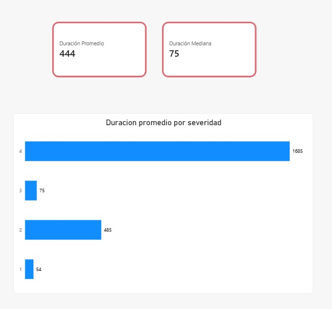
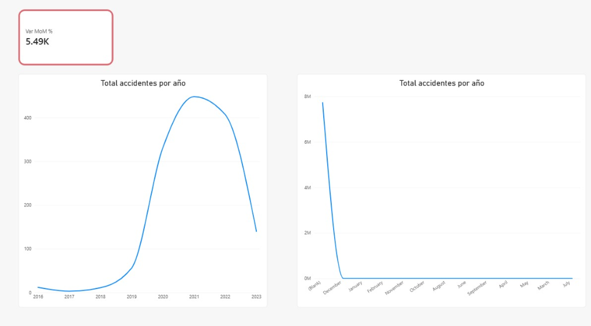
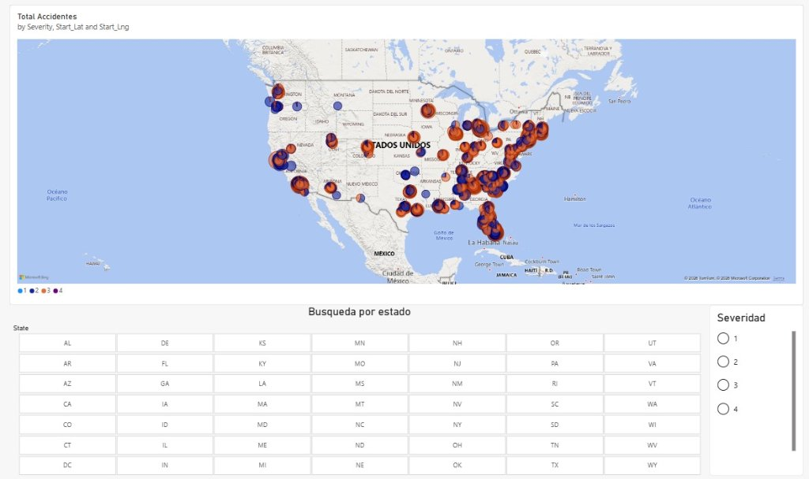

---

## 5. Medidas DAX Explicadas

Las definiciones completas y comentadas se encuentran en [`powerbi/dax_measures.md`](../powerbi/dax_measures.md):

1. **`Total Accidentes = COUNTROWS(Accidents)`**: Métrica base aditiva sobre la tabla de hechos que responde a cualquier segmentación de Estado, Ciudad, Clima, Fecha o Severidad (`7,728,394` / `8M`).
2. **`Accidentes FinDeSemana = CALCULATE([Total Accidentes], WEEKDAY(Accidents[Start_Time], 2) IN {6, 7})`**: Modifica el contexto de filtro para aislar sábados y domingos (`1,231,427` reales en todo el histórico).
3. **`Accidentes YTD = TOTALYTD([Total Accidentes], Dim_Calendario[Date])`**: Acumulado anual hasta la fecha máxima del contexto activo (marzo de 2023).
4. **`Var MoM % = DIVIDE([Total Accidentes] - [Accidentes Mes Anterior], [Accidentes Mes Anterior], 0)`**: Variación porcentual mensual usando `DATEADD(..., -1, MONTH)` protegida ante división por cero.
5. **`Duración Promedio` (`AVERAGE`) y `Duración Mediana` (`MEDIAN`)**: Par de medidas que diagnostican la asimetría de los tiempos de atención (`444 min` vs `75 min`).
6. **`Tasa x 100k Hab = DIVIDE([Total Accidentes] * 100000, MAX(Dim_Demografia[Population_2023]), 0)`**: Medida de normalización demográfica integrada mediante la tabla del Censo EE.UU.

---

## 6. Resultados y Visualización del ANOVA

Se ejecutaron **4 modelos ANOVA exactos** sobre la totalidad de los registros depurados en Python (`src/anova_analysis.py`), acompañados de verificación no paramétrica (**Kruskal-Wallis H**), prueba de homogeneidad de varianzas (**Levene**), corrección ante heterocedasticidad (**Welch ANOVA**) y contrastes múltiples post-hoc (**Tukey-Kramer HSD**).

### 6.1 Tabla Resumen de Pruebas ANOVA

| Modelo Evaluado | N Válido | F Clásico | p-valor | $\eta^2$ (Tamaño del Efecto) | F Welch | Kruskal-Wallis H | Conclusión Estadística |
|---|---|---|---|---|---|---|---|
| **1. Duración (≤24h) ~ Severidad** | 7,693,413 | **86,966.69** | `< 1e-300` | **0.03280** | 183,159.02 | 580,876.4 | Se rechaza $H_0$: la severidad determina diferencias altamente significativas en duración. |
| **2. Severidad ~ Clima** | 7,728,394 | **4,663.12** | `< 1e-300` | **0.00301** | 4,684.43 | 29,167.6 | Se rechaza $H_0$: el clima altera significativamente la severidad promedio (Lluvia/Otro más graves). |
| **3. Severidad ~ Franja Horaria** | 7,728,394 | **726.09** | `< 1e-300` | **0.00038** | 678.00 | 1,419.8 | Se rechaza $H_0$: la franja horaria (noche/madrugada vs pico) incide en la severidad. |

### 6.2 ANOVA Factorial de 2 Vías: `Severidad ~ Clima × Franja Horaria`

| Fuente de Variación | gl (df) | Suma de Cuadrados (Tipo III) | Cuadrado Medio | F | p-valor | Eta Parcial² |
| --- | --- | --- | --- | --- | --- | --- |
| weather_group | 5 | 4,551.10 | 910.2196 | 3,843.64 | 0.00e+00 | 0.002481 |
| time_slot | 4 | 69.25 | 17.3122 | 73.11 | 4.68e-62 | 0.000038 |
| weather_group × time_slot (Interacción) | 20 | 414.78 | 20.7392 | 87.58 | 0.00e+00 | 0.000227 |
| Error (Dentro de celdas) | 7,728,364 | 1,830,167.66 | 0.2368 | - | - | - |

### 6.3 Estadísticos por Grupo (Duración ~ Severidad y Severidad ~ Clima)

| Severidad | n | Media (min) | Desv. Est. | Mediana (min) | IC 95% |
| --- | --- | --- | --- | --- | --- |
| 1 | 67,356 | 45.7278 | 29.1757 | 44.75 | [45.5075, 45.9482] |
| 2 | 6,126,329 | 114.6924 | 127.8555 | 77.43 | [114.5911, 114.7936] |
| 3 | 1,298,989 | 67.7818 | 80.5894 | 44.4 | [67.6432, 67.9204] |
| 4 | 200,739 | 185.9008 | 158.3213 | 126.97 | [185.2082, 186.5934] |

| Clima | n | Severidad Media | Desv. Est. | IC 95% |
| --- | --- | --- | --- | --- |
| Despejado | 3,405,216 | 2.1844 | 0.4714 | [2.1839, 2.1849] |
| Lluvia | 600,536 | 2.2462 | 0.5007 | [2.2449, 2.2474] |
| Niebla | 202,142 | 2.1789 | 0.4487 | [2.177, 2.1809] |
| Nieve/Hielo | 179,916 | 2.2373 | 0.5094 | [2.2349, 2.2396] |
| Nublado | 3,163,750 | 2.2345 | 0.4985 | [2.234, 2.2351] |
| Otro | 176,834 | 2.2526 | 0.5339 | [2.2501, 2.2551] |

**Interpretación Práctica vs. Significancia Estadística:**  
Dado el tamaño masivo ($N > 7.7$ millones), casi cualquier diferencia mínima produce $p < 0.001$; por ello es fundamental analizar el **tamaño del efecto ($\eta^2$)** y las **diferencias reales de medias (Tukey HSD)**:
- En **Duración ~ Severidad**, el efecto es **sustantivo** ($\eta^2 = 0.0328$): los incidentes de Severidad 4 promedian `185.9 min` (vs `45.7 min` en Severidad 1 y `67.8 min` en Severidad 3), resultando **todos los 6 pares significativos** en Tukey-Kramer HSD (`p < 1e-300`).
- En **Severidad ~ Clima × Franja Horaria**, tanto los efectos principales como la **interacción son significativos** (`F = 87.58`, `p < 1e-300`): mientras en `Lluvia`, `Nublado` y `Despejado` la severidad máxima ocurre en horario nocturno (`20–23h`, ej. Lluvia nocturna = `2.279` vs pico tarde = `2.230`), en `Nieve/Hielo` y `Niebla` la gravedad promedio es mayor al mediodía (`2.259` y `2.203`).

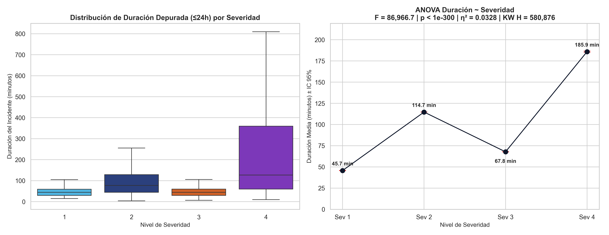

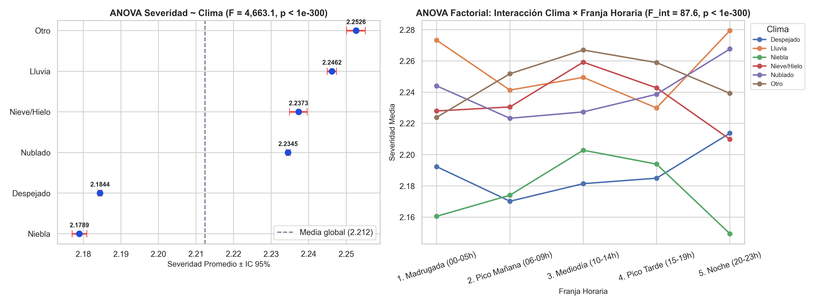

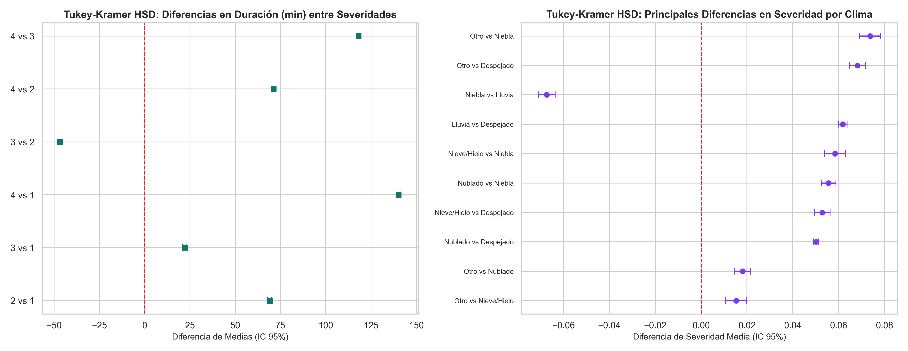

---

## 7. Conclusiones y Recomendaciones

1. **Concentración geográfica y enfoque per cápita:** California (`1.74M`), Florida (`880K`) y Texas (`583K`) lideran en volumen bruto, mientras Miami, Houston y Los Ángeles encabezan la siniestralidad urbana. Sin embargo, al cruzar con datos demográficos del Censo, Carolina del Sur (`7,119` x 100k hab.) y Oregón (`4,244` x 100k hab.) superan en riesgo relativo per cápita, demostrando que la planeación vial debe combinar volumen absoluto e incidencia ajustada por población.
2. **Ventana crítica de gestión del tráfico:** La siniestralidad alcanza su máximo los **viernes (`17.68%`)** y entre las **15:00 y 18:00 horas** (pico vespertino), siendo las **autopistas interestatales** (`I-95`, `I-5`, `I-10`) los corredores con mayor proporción de eventos graves (`32.44%` en `Sev 3–4`).
3. **Impacto climático y nocturno:** Aunque el 85% de los incidentes ocurre en clima despejado o nublado por mayor exposición vehicular, la **lluvia (`22.76%` graves)** y la **nieve/hielo (`19.95%` graves)** elevan de forma estadísticamente significativa la severidad promedio (ANOVA $p < 10^{-300}$), con interacción significativa según la franja horaria.
4. **Control de calidad de datos y gobernanza BI:** La auditoría conjunta Python + SQL + Power BI permitió detectar y corregir *timestamps* con nanosegundos (`.000000000`), separar *outliers* de duración superiores a 24 horas (explicando la brecha media `444 min` vs mediana `75 min`), corregir el orden alfabético en el ranking de vías y depurar falsos positivos toponímicos en la extracción NLP de tipos de vehículo.
